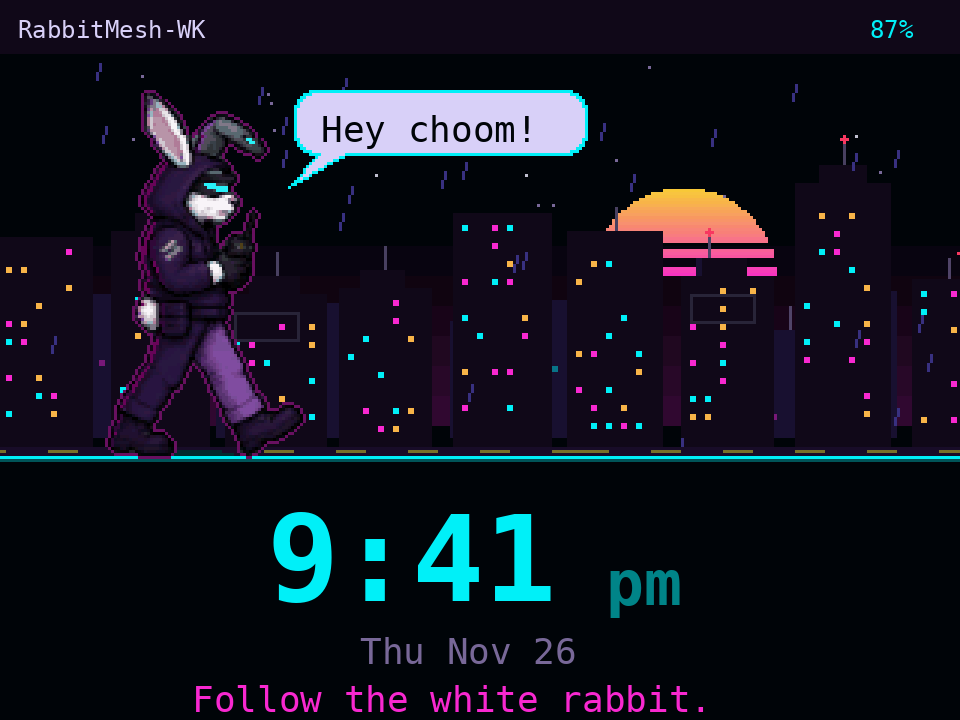
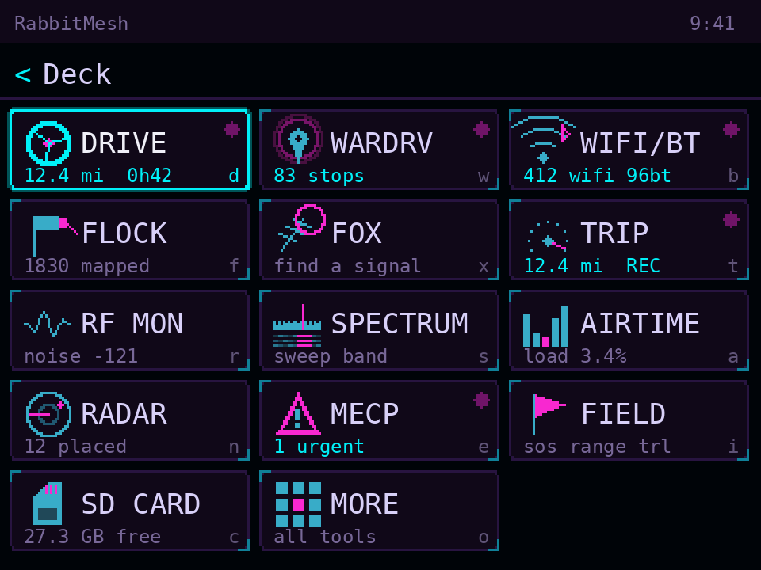
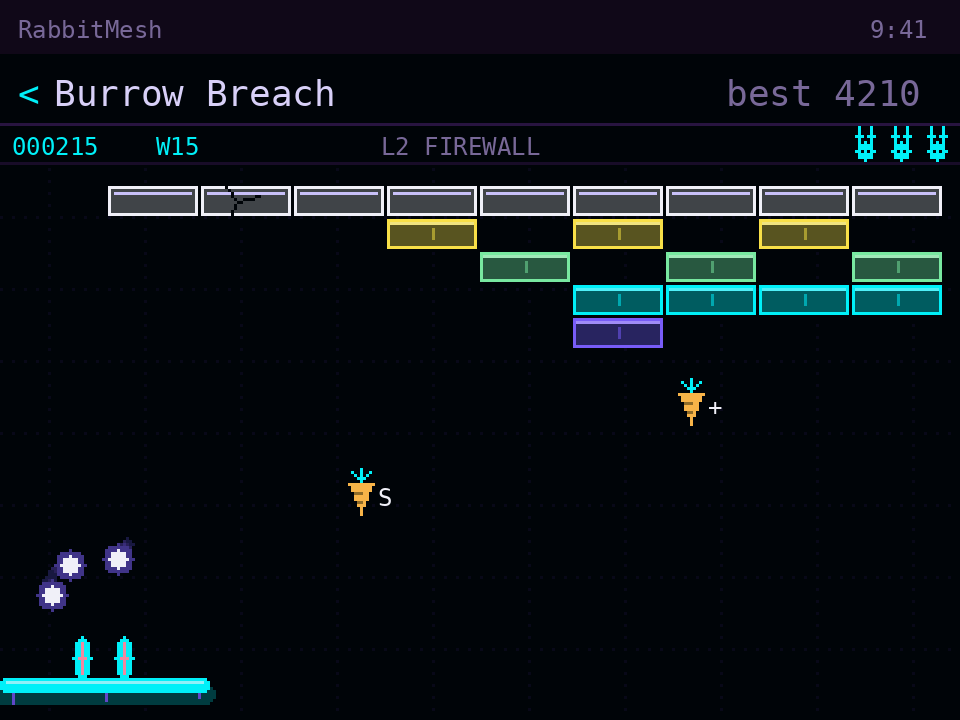
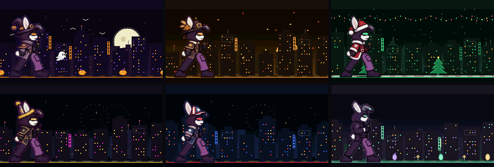

# RabbitMesh

Mesh firmware for the **LilyGo T-Deck / T-Deck Plus**, with a cyberpunk rabbit. A hooded rabbit walks and talks on the lock screen, and a hub of radio and field tools called the **Deck** puts wardriving, ALPR-camera hunting and signal hunting in your pocket. It runs on [MeshCore](https://github.com/meshcore-dev/MeshCore), so it talks to every other MeshCore device and the MeshCore phone app.



- **Wardriving:** LoRa mesh coverage, and WiFi + Bluetooth to a WiGLE file, with one press (**Drive mode**).
- **Flock hunt:** a map of ALPR cameras around you, warnings as you approach, and the radio listening for them.
- **Signal tools:** fox hunt (LoRa, WiFi or Bluetooth, with a "which way is stronger" arrow), spectrum analyzer, RF monitor and packet log.
- **Field tools:** MECP emergency messages, SOS, range test, trip logging with GPX, nearby-contacts radar.
- **Themes:** Neon Rabbit, Red Team and Blue Team, and holiday costumes that come round by themselves.

Built on [Squatch Mesh](https://github.com/BamBam1121/inw-mesh), with tools that started from [WadaMesh](https://github.com/ALLFATHER-BV/wadamesh). See [Credits](#credits--license).

## What you need

- A **LilyGo T-Deck or T-Deck Plus**. The Plus has GPS built in; a plain T-Deck needs one added for the GPS tools.
- A **microSD card** for the logs (wardrive, WiGLE, tracks, camera map), formatted **FAT32** (see [The SD card](#the-sd-card)). Most tools still run without one.
- A computer with **Chrome or Edge** to flash it.

## Install

You need two files from the [latest release](../../releases/latest), or build them yourself ([docs/DEVELOPMENT.md](docs/DEVELOPMENT.md)):

| File | Flash at | When |
|---|---|---|
| `rabbitmesh-<version>-tdeck-full.bin` | `0x0` | **First install**, coming from any other firmware. It replaces everything, settings included, so back up first. |
| `rabbitmesh-<version>-tdeck-update.bin` | `0x10000` | **Updating** RabbitMesh. Keeps your settings, contacts and identity. |

1. Put the T-Deck in download mode: **hold the trackball down** while you switch it on, then plug it in by USB.
2. Open the [Espressif web flasher](https://espressif.github.io/esptool-js/) in Chrome or Edge, set the baud rate to 921600, and press **Connect**.
3. Add the file at its address from the table and press **Program**. When it's done, switch the T-Deck off and on.

> **Updating: don't erase first.** Erasing wipes the bootloader, and the update file alone can't start the T-Deck. If that happens, flash the **full** file at `0x0` and it boots again.

From a terminal instead (`pip install esptool`):

```bash
esptool.py --chip esp32s3 write_flash 0x0 rabbitmesh-0.1.0-tdeck-full.bin       # first install
esptool.py --chip esp32s3 write_flash 0x10000 rabbitmesh-0.1.0-tdeck-update.bin # update
```

## First steps

1. **Pair the phone app (optional).** Each T-Deck picks its own Bluetooth PIN. Find it under **Settings > Bluetooth**.
2. **Save your WiFi network** under **Settings > WiFi**. It sets the clock, and lets the T-Deck download the camera map by itself.
3. **Get a GPS fix once**, outside. That sets the time zone; after that it works indoors too.
4. **Open the Deck** with `t` on the home screen. Every tile shows its shortcut letter:



| Key | Tool | What it's for |
|---|---|---|
| `d` | **Drive** | one press starts the trip, mesh survey, WiFi + BT wardrive and camera warnings; a summary when you stop |
| `w` | **Wardrive** | mesh coverage: which repeaters hear you, and how well, on the map |
| `b` | **WiFi/BT** | WiFi networks and Bluetooth devices to a WiGLE CSV you can upload at wigle.net; "follow one" walks one down with the arrow |
| `f` | **Flock** | the ALPR camera map, approach warnings, and listening for cameras |
| `x` | **Fox** | walk a signal down: any mesh signal, one repeater, one WiFi network or one Bluetooth device |
| `t` | **Trip** | speed, distance, time and a GPX track; survives a restart |
| `r` | **RF Monitor** | signal, noise, the latest packets; pick one to see who sent it; `l` logs every packet |
| `s` | **Spectrum** | a sweep of the band around your mesh channel (the mesh pauses while it sweeps) |
| `a` | **Airtime** | how busy the channel is |
| `n` | **Radar** | contacts with a position, around you |
| `e` | **MECP** | emergency codes: write them, and get alerted by MAYDAY/URGENT |
| `i` | **Field** | range test, SOS, breadcrumb trail |
| `c` | **SD card** | what's on the card; look at or delete files; formats a card the T-Deck can't read |
| `g` | **Game** | Burrow Breach: knock down the firewall with the rabbit's hoverboard (see below) |
| `o` | **More** | every other tool and setting |

Each tool says what it's waiting for, such as `needs: gps fix ok, sd card NO`. The details of every tool are in **[docs/TOOLS.md](docs/TOOLS.md)**.

### Burrow Breach



A brick-breaker for the downtime. The rabbit's hoverboard bats a data packet into a firewall, five levels of it, then round again faster. White ICE blocks take two hits. Broken blocks sometimes drop a carrot: **W** a wider board, **M** three packets, **S** a slower packet, **+** a life. Roll the trackball (or `a` / `d`, or a finger on the screen) to move, press to launch, `p` to pause, `s` for sound, backspace to quit. Your best score is kept. The mesh carries on while you play: messages arrive as usual, and the game pauses itself when the screen goes dark.

## Themes

Neon Rabbit (a rainy neon city, the default), **Red Team** (a data centre after hours) and **Blue Team** (a security operations centre). On holidays the rabbit dresses up by himself: Halloween, Thanksgiving, Christmas, New Year's, Easter and the 4th of July. Your own theme comes back after. Turn it off under the theme menu's "holiday themes by date".



More about the character and how he's drawn: [docs/CHARACTER.md](docs/CHARACTER.md).

## Privacy: what it sends, and where

- **It never updates itself, and never reports anything** to the projects it's built on. You update it only by flashing it.
- **New versions:** once a week, while on WiFi, it asks this project's GitHub page for the newest version number, and tells you if there's a newer one. Nothing about you or your device is sent, and nothing is installed. Turn it off under Settings > System.
- **WiGLE:** RabbitMesh only writes the file. It never contacts WiGLE; uploading is up to you.
- **The only internet addresses in the firmware:**
  - `data.dontgetflocked.com`: the camera map, when you update it (at most once a day);
  - `tile.openstreetmap.org`: map tiles while you look at the map;
  - `pool.ntp.org` and `time.google.com`: the clock;
  - `api.github.com`: the weekly new-version check above.
- **Flock hunt** only listens. Nothing is ever transmitted at a camera.

## Staying up to date

RabbitMesh tracks [MeshCore](https://github.com/meshcore-dev/MeshCore): each MeshCore release gets a RabbitMesh build on it. A T-Deck only changes firmware when you flash it, so:

- **Your T-Deck tells you** when a new version is out (once a week, on WiFi), and Settings > System > check for updates asks now.
- **Or watch this repository:** Watch > Custom > Releases on GitHub emails you when there's a new one.
- **To update:** flash the new **update** file at `0x10000` (see Install). Your settings and contacts stay.

## The SD card

The T-Deck reads **FAT32** only. Cards of 32 GB and under usually come that way. Bigger cards (64 GB and up) come as **exFAT**, which the T-Deck can't read, so it acts as if there's no card. Any size works once it's FAT32.

- **Easiest: on the T-Deck.** Put the card in, open Deck > SD card (`c`). If the card can't be read, it offers **format it as FAT32**. That erases the card.
- **Windows:** File Explorer only offers FAT32 up to 32 GB. For a bigger card use a free tool such as [Rufus](https://rufus.ie) (Boot selection: Non bootable, File system: FAT32) or format it on the T-Deck.
- **Mac:** Disk Utility > View > Show All Devices, select the card itself (not the volume under it), Erase, Format: **MS-DOS (FAT)**, Scheme: **Master Boot Record**.
- **Linux:** `sudo mkfs.vfat -F 32 /dev/sdX1` (check the device name first).

Push the card in until it clicks. You can put it in with the T-Deck on; the SD card page looks again each time you open it.

## Troubleshooting

- **"No sd card" with a card in.** Open Deck > SD card. "Can't be read" means it isn't FAT32: format it there (or see [The SD card](#the-sd-card)). "No sd card found" means the slot doesn't see it: push it in until it clicks, or try another card.

- **The clock is wrong or shows UTC.** Get a GPS fix outside once, connect the phone app, or save a WiFi network. With none of those, it sets the clock from the mesh once three nearby nodes agree on the time.
- **"No camera map".** Flock > update camera map. It needs an SD card and a saved WiFi network; it turns the WiFi on and off by itself.
- **The flock hunt says "Liteon radio - laptops use these too".** That's a laptop or similar, not a camera. Camera-grade hits are shown in red and sound an alarm.
- **A tool seems to do nothing.** Read its "needs:" line: usually a GPS fix, the SD card, or the WiFi setting.
- **It won't boot after flashing.** Flash the full file at `0x0` (see Install).

## Building from source

`pip install platformio`, then `pio run -e t-deck-rabbit` in this folder. Everything it needs is in this repository. Everything else (the flash files, tests, previews, the code map and the MeshCore version) is in **[docs/DEVELOPMENT.md](docs/DEVELOPMENT.md)**.

## Credits & license

GPL-3.0, like both projects it's built from.

- [Squatch Mesh](https://squatchmesh.com) / [BamBam1121/inw-mesh](https://github.com/BamBam1121/inw-mesh): GPL-3.0. RabbitMesh is built on its T-Deck firmware (tag `tdeck-v1.2.7`), whose source is in this repository with RabbitMesh's changes; its own third-party notices are in `licenses/SQUATCH-THIRD_PARTY.md`
- [WadaMesh](https://wadamesh.com) / [ALLFATHER-BV/wadamesh](https://github.com/ALLFATHER-BV/wadamesh): GPL-3.0. Wardrive design, including the probe-not-listen approach, both-way links and the review mode, by the WadaMesh contributors (Wardrive 1.2 review by tmetz1987)
- [MECP](https://github.com/xiang-dev-1/MECP) by xiang-dev-1: the protocol is CC0; the English code table in `src/mecp_core.h` is CC BY 4.0
- [MeshCore](https://github.com/meshcore-dev/MeshCore)
- [flock-you](https://github.com/colonelpanichacks/flock-you) by colonelpanichacks, MIT (`licenses/flock-you-MIT.txt`): the Flock camera signatures and detection method in `src/flock_core.h`, built on research by @NitekryDPaul ([nite-oui-collection](https://github.com/nitekry/nite-oui-collection)) and DeFlockJoplin
- [DeFlock](https://deflock.org) and [deflock-data](https://github.com/flockhopper3/deflock-data) (MIT): the camera map's source; the cameras themselves are © [OpenStreetMap](https://www.openstreetmap.org/copyright) contributors, ODbL
- [miniz](https://github.com/richgel999/miniz), MIT (`licenses/miniz-MIT.txt`): the gzip inflate the host tests use (the T-Deck uses the copy in the ESP32-S3 ROM)
