# The character and themes

The rabbit on the lock screen walks with **hand-drawn frames**: the owner's walk-cycle sheet (`art/sheets/rabbit_walk_sheet_v5.png`, 8 frames in a grid, drawn walking in place). It's cut into `art/walk/walk_0..7.png` by `tools/slice_sheet.py`, which checks that the visor and feet line up in every frame. `tools/make_sprite.py` then turns those into 8 palette frames of 81 × 124 (64 colours shared by all frames, about 68 KB of flash in `src/rabbit_sprite.cpp`, one copy). The generated sprite files are committed, so building doesn't need Python.

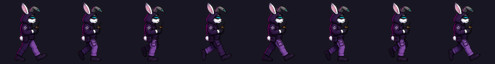

He's animated the way Squatch Mesh animates its sasquatch: **he walks the wet street while the city scrolls past**, the near towers faster than the far ones, and the lane marks stream under his feet at the ground's own speed. The firmware plays the frame for the current point in the stride (about 2.5 lock-screen frames each) and animates the rest on top:

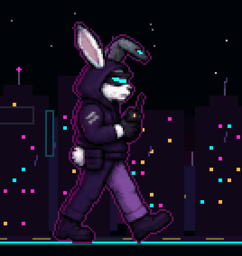 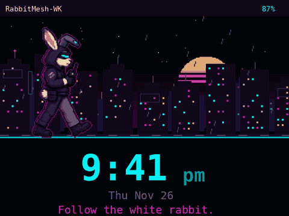

- **Ears:** they sway a beat behind each step, split at the gap the converter finds between the white ear and the mechanical one. They droop when he's tired and perk up when he's happy.
- **Radio:** when he talks he lifts it to his mouth, its screen lights, and rings go out of the antenna. When he says hello or calls out a new message, he holds it up.
- **Visor:** glows in the theme's accent, or amber when messages are waiting. It pulses, dims when he blinks, shows `^ ^` when he's happy, and sits half-lit when he's tired. Stars circle his head when he's dizzy.
- **Outline:** a rim light in the theme's second colour keeps him visible against the dark city. The sheet's soft glow is trimmed to the figure.
- **Like the sasquatch:** the speech bubble points at his face, clear of the mechanical ear, he hops when poked, and he walks through the screen changes too.

| Unread messages | Poses: idle, blink, happy, tired, dizzy, on air |
|---|---|
| 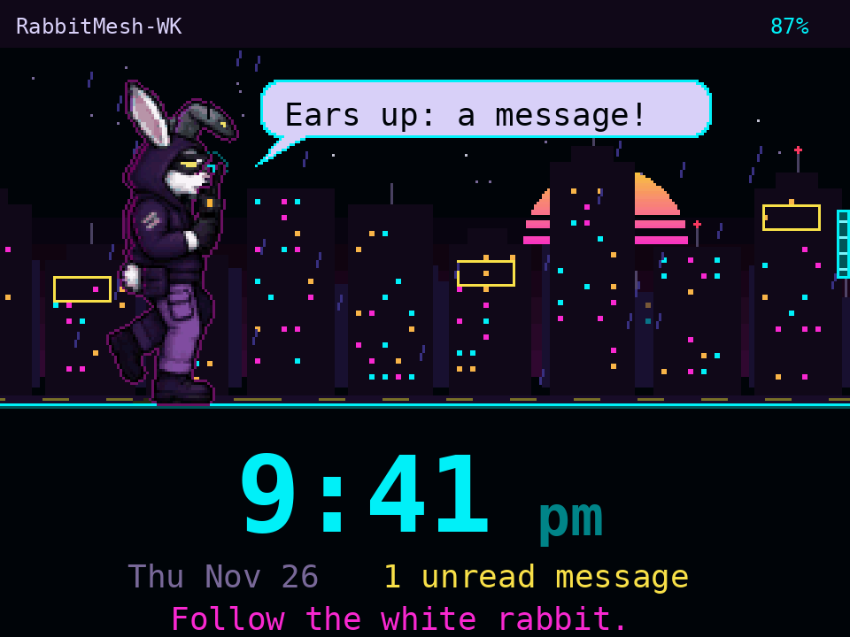 | 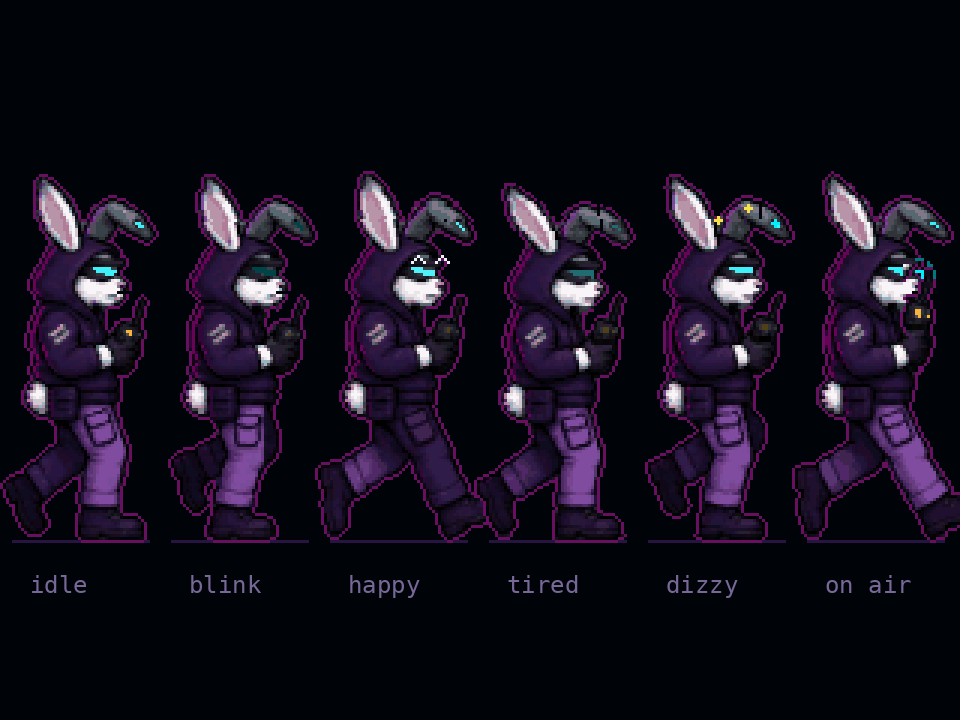 |

**The art in use is the owner's redraw** (`art/sheets/rabbit_walk_sheet_v5.png` and `art/talk_pose.png`): eight distinct walk poses with high-knee passing steps, and a talking pose in the same style, so he doesn't change look when he stops to talk.
- **Planted foot:** 1.4–1.5 px of slide a frame on average; the first painted walk managed 1.3.
- **Talk frames:** none has a transparent hole, and all fit 44 px wide.

**New art.** For a new sheet, run `python3 tools/slice_sheet.py SHEET.png --cols C --rows R --ref art/rabbit.png`, then `python3 tools/make_sprite.py` and `preview/check.sh build`. Frame 0 doubles as the reference pose the joints are measured on. A single standing picture also works: `tools/make_walk.py` builds walk frames from it by turning the legs at hip and knee. With no walk frames at all, the firmware bends the single pose.

**Compared with Squatch Mesh's sasquatch** (`preview/check.sh` renders both on the same frames at the same pace and measures them):

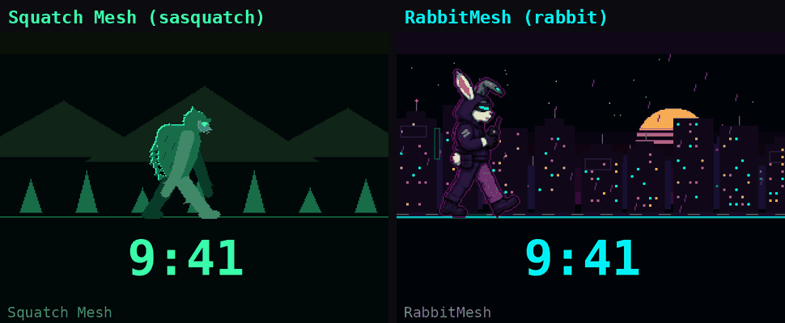

| one stride, at lock-screen size | Sasquatch | Rabbit |
|---|---|---|
| frames per stride | 20, all different | 20, all different |
| body bob | 3 px, 1 px a frame at most | 2 px, in step with the drawings: down at contact, up passing |
| how far the legs open | 19–66 px | 25–58 px |
| knees | bend | bend (drawn) |
| draw calls for the character | 78 | 1: composed in a buffer, then one clipped `pushImage` |
| whole lock frame | 149 calls | 429 calls (the city's windows and rain) |
| stress test (ASan/UBSan, every pose, sizes 10–200, half off-screen) | | 10,692 frames, no errors, nothing outside its box |

Both now walk with real frames: the sasquatch with shapes drawn in code, the rabbit with the hand-drawn cycle. Both bob in the same rhythm, up as the legs pass and down at contact (the sasquatch 3 px, the rabbit 2 px), with their feet on the ground throughout. The difference left is cadence. The sasquatch's legs move every screen frame. The rabbit's change every 2–3, eight drawings per stride, the usual pace for a pixel-art walk.

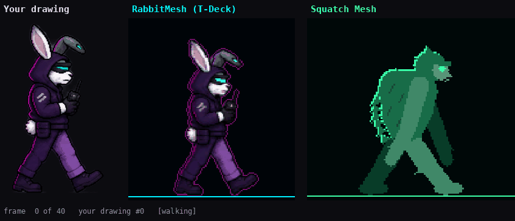

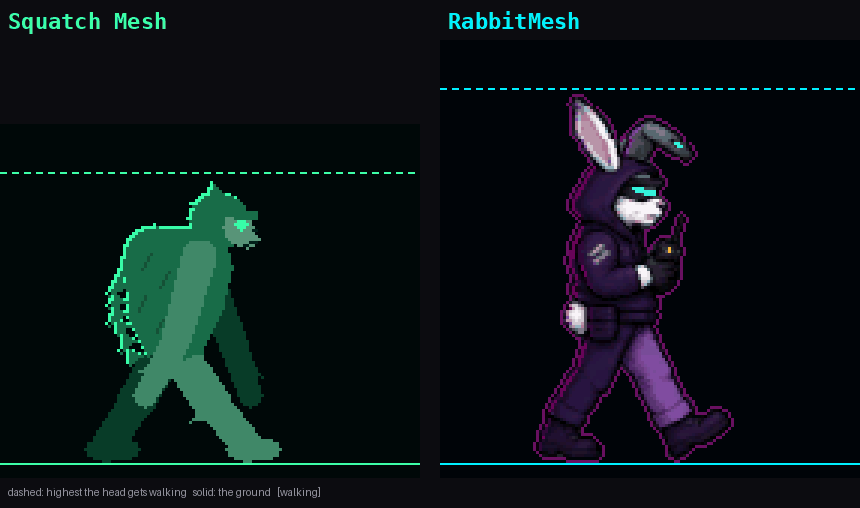

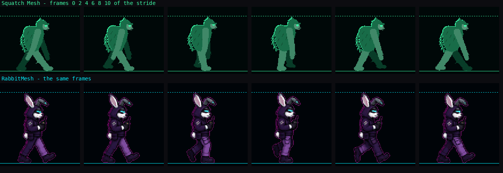

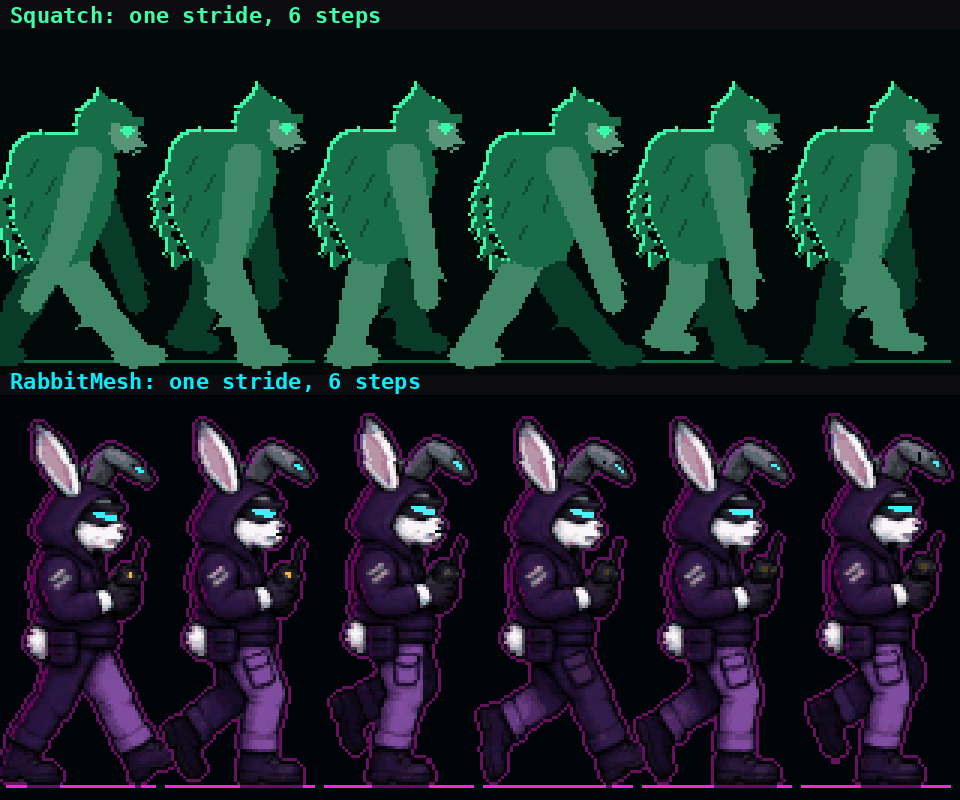

## Themes

RabbitMesh offers nine themes, all its own: three for every day, and six holidays.

| Theme | Lock scene |
|---|---|
| Neon Rabbit (default) | the rainy neon city |
| Red Team | a data centre after hours: racks with blinking status lights, cable trays, a turning red beacon; with something unread a rack's alarm strobes |
| Blue Team | a security operations centre: a wall of monitors (logs, traffic graphs, radar, attack arcs over a map) and analysts' desks; with something unread a screen flashes ALERT |
| Halloween | a purple night, a huge moon, bats, fog, jack-o'-lanterns along the kerb; he's in a witch's hat and cape, a ghost floating along beside him |
| Thanksgiving | an amber dusk, a low harvest moon, leaves blowing down the street; he's in a pilgrim's hat and coat |
| Christmas | snow, lights strung over the street, neon trees; he's in Santa's hat and coat |
| New Year's | fireworks over the skyline in gold, silver and magenta; he's in a party hat and a gold-trimmed coat |
| Easter | a pastel dawn, glowing eggs and flowers along the kerb |
| 4th of July | fireworks in red, white and blue; he's in a stars-and-stripes cap and jacket |


On a holiday he says the season's lines a third of the time ("Trick or treat, choom!", "Snow on the antennas."). The costumes are the owner's art: one sheet (`art/costumes/holiday_atlas.png`) with a stride and a talking pose for each of the five. `tools/make_holiday_frames.py` builds every walk and talk frame from them: the costume's upper body (hat, head, coat, arms, tail) set on the belt line of each base frame, over that frame's own pants and boots, so the stride, its timing, the boot baseline and the planted foot are exactly the everyday rabbit's (`art/holiday/<name>/`). `tools/make_holiday_sprites.py` turns them into one complete sprite set per holiday on the base sprite's canvas, each with its own palette, packed as runs (`src/holiday_sprite.cpp`, about 43 KB a holiday). On those days the lock screen draws that set in place of the base frames, one whole sprite a frame. The ghost is the owner's art too (`art/costumes/costumes_sheet.png` via `tools/make_costumes.py`). Each holiday has its own sounds. All six add about 230 KB to the firmware.

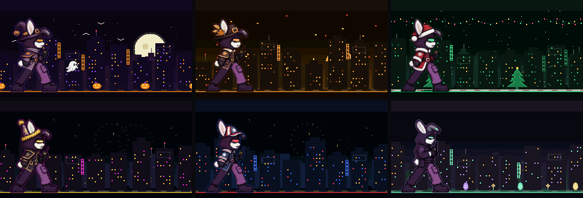

The rabbit walks Red Team and Blue Team as he walks the city, says his own lines there and hops through their screen changes (`src/scene_cyber.h`). Each has its own tunes and vibration patterns. The upstream firmware's themes (its four base looks, its Halloween and Squatchmas) stay in its table only so saved theme ids and backups keep their numbers. None is offered, and the theme maker's custom themes aren't either: any saved id that isn't one of RabbitMesh's nine shows the Neon Rabbit.

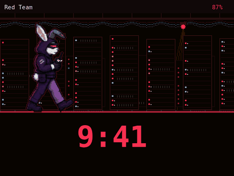 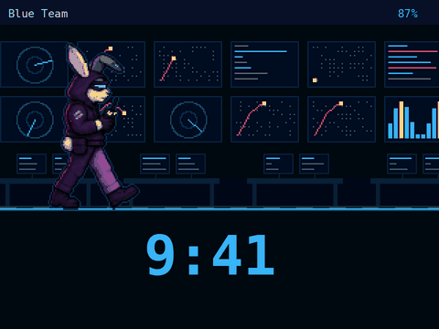

## Walking between lines, and stopping to talk

On the lock screen he walks until Squatch's talk system puts a line up (`squatch_talk.h` now sets `SquatchPose::talking`). Then he walks on to the next passing step, stops, raises the radio over four talk frames (`art/talk/talk_0..3.png`), talks with his mouth following the words, lowers the radio once the bubble has been gone a moment, and walks on. While he stands, the street, lane marks and towers stand too: they only move with his stride.

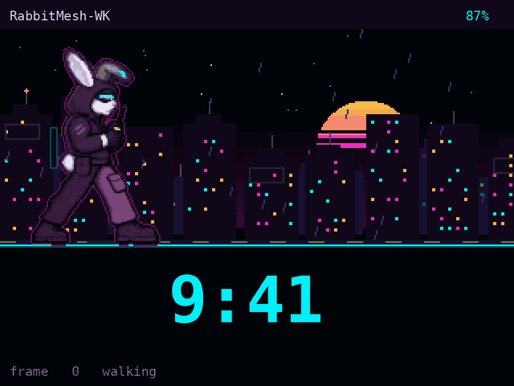

**Planted foot and lean** (`preview/plant.cpp`, run by `check.sh`). The street moves under him by exactly what each drawing's planted boot travels (`STANCE_DX`, measured by `make_sprite.py`), not an even share of the stride. The trailing boot at a contact moves with it until it lifts.

| | Sasquatch | Rabbit |
|---|---|---|
| weight foot sliding on the street | 3.2 px a frame on average, 6 at worst | 1.3 px on average; 0–1 within a drawing, 6–9 px at 2 of the 8 drawing changes (the hand-drawn boots don't line up exactly there) |
| forward lean (head ahead of hip) | 2–13 px, surging each step | 9–13 px, always forward, surging each step |

The weight passes to the other foot as he leaves each contact drawing; that change isn't counted as a slide.

**The jacket under the arm.** `tools/make_talk.py` builds the talk frames from `art/talk_pose.png`. It turns the arm about the elbow and the wrist, then paints jacket under where the arm was, so the city never shows through the shoulder or chest. `preview/walk_talk.cpp` renders every talk frame over a bright checkerboard, in a 44 × 124 box and at full width, and counts the transparent pixels inside his outline:

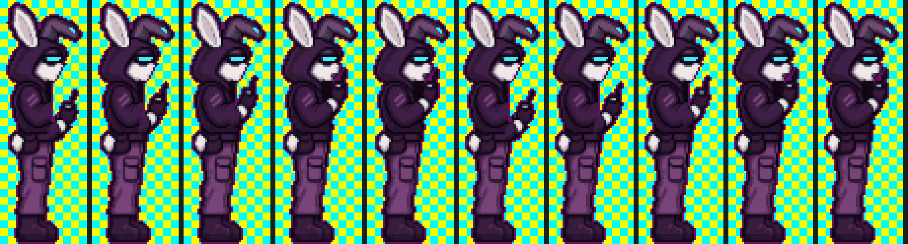

- **Holes:** 0 in every talk frame, with the mouth open or shut.
- **Gap:** talk_3 has 8 px of deliberate gap between the radio and his mouth.
- **Width:** with the redrawn talking pose (below) every talk frame fits a 44 × 124 box: 39 px wide at 123 px tall. The walk frames are wider, because his legs open to about 80 px mid-stride.

The joints ("the rig": hip row, the column between the legs, the base of the ears, the radio arm's box) are written into `src/rabbit_sprite.h`. If new art walks oddly, check them there and override with `tools/make_sprite.py --rig HIP,SPLIT,EAR,AX0,AY0,AX1,AY1`.

To change his look, replace the art (any size, transparent background, standing figure) and run:

```bash
python3 tools/make_walk.py                    # art/rabbit.png -> art/walk/walk_0..7.png (skip for hand-drawn frames)
python3 tools/make_sprite.py                  # art/ -> src/rabbit_sprite.h + .cpp (height 122 + rim)
preview/render.sh build                       # then look at preview/out/lock_*.png and preview/out/walk/lock-walk.gif
```
