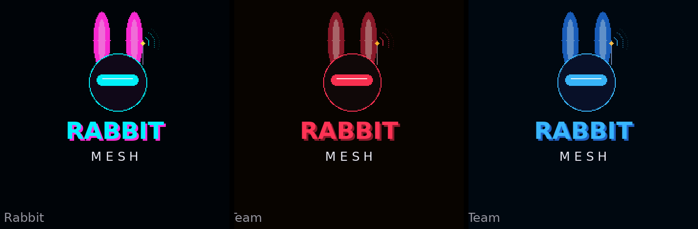
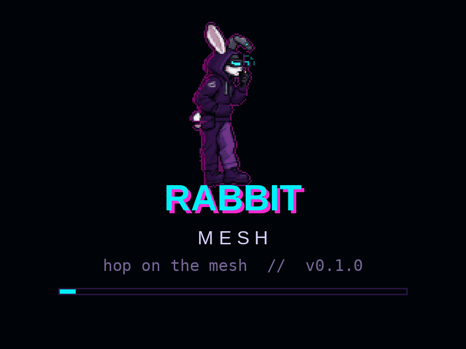

# Building and working on RabbitMesh

For installing a ready-made build, see the [README](../README.md). This page is for building it yourself and for changing it.

## How the source is put together

RabbitMesh doesn't copy the firmware it builds on. `setup.sh` fetches [Squatch Mesh](https://github.com/BamBam1121/inw-mesh) at a pinned commit (`tdeck-v1.2.7`), applies `patches/rabbitmesh-tdeck.patch` (RabbitMesh's edits to Squatch's own files), and copies RabbitMesh's own files from `src/` in beside them, into `./build`. MeshCore and the other libraries come in through PlatformIO.

You need [PlatformIO](https://platformio.org) (`pip install platformio`) and git.

```bash
./setup.sh                           # fetch Squatch Mesh, patch it, add src/ -> ./build
cd build
pio run -e t-deck-rabbit             # build
pio run -e t-deck-rabbit -t upload   # flash over USB: hold the trackball while powering on for download mode
```

Back up the T-Deck first (Settings > backup). The build uses about 82% of the app slot and 43% of RAM.

To change RabbitMesh, edit `src/` here (or, for a change to one of Squatch's files, the file in `build/` and then regenerate the patch with `cd build && git diff > ../patches/rabbitmesh-tdeck.patch`), copy `src/` into `build/src`, and build again.

**The two flash files.** After `pio run`, from the `build` folder:

```bash
B=.pio/build/t-deck-rabbit
esptool.py --chip esp32s3 merge_bin -o rabbitmesh-tdeck-full.bin --flash_mode dio --flash_freq 80m --flash_size 16MB \
  0x0 $B/bootloader.bin 0x8000 $B/partitions.bin \
  0xe000 ~/.platformio/packages/framework-arduinoespressif32/tools/partitions/boot_app0.bin 0x10000 $B/firmware.bin
cp $B/firmware.bin rabbitmesh-tdeck-update.bin
```

**Sharing it.** RabbitMesh is GPL-3.0, like Squatch Mesh and WadaMesh. Anyone you give a binary to has the right to its source, so post the binary together with a link to this repository at the commit (or release) you built it from.

## Testing without a T-Deck

```bash
test/run.sh                  # host tests: every tool's logic (wardrive, deck, spectrum, MECP, fox, WiGLE,
                             # flock, holidays, time zone, mesh clock, camera map)
preview/render.sh build      # the lock scenes, the rabbit and the Deck screens, through the real drawing code,
                             # to preview/out/*.png
preview/check.sh build       # the animation checks: the walk, the talk frames, a stress test under ASan/UBSan
```

## Where things are

```
setup.sh                         fetch upstream at a pinned commit, patch it, copy src/ in
patches/rabbitmesh-tdeck.patch   RabbitMesh's edits to Squatch Mesh's own files

src/deck.{h,cpp}                 the Deck hub, RF Monitor (+ packet detail and packet log), Airtime, Radar, Trip
src/deck_draw.h                  how the Deck's screens look (shared by the device and the preview)
src/drive.{h,cpp}                Drive mode: one press for a drive, and its summary
src/wardrive.{h,cpp}             the mesh coverage survey, its log, menus and map overlay
src/wifidrive.{h,cpp}            the WiFi + Bluetooth wardrive (WiGLE CSV)
src/flock.{h,cpp}                the Flock hunt: the camera map and the radio listening
src/fox.{h,cpp}                  the fox hunt (any signal, a repeater, a WiFi network)
src/spectrum.{h,cpp}             the spectrum analyzer: borrowing the radio, the sweep, handing it back
src/mecp.{h,cpp}                 MECP emergency messages: write, inbox, alerts
src/sdview.{h,cpp}               the SD card viewer
src/needs.h                      the "needs: gps fix ok, sd card NO" line
src/meshclock.{h,cpp}            the clock from the mesh
src/tzauto.{h,cpp}               the time zone from location
src/holiday.{h,cpp}              the holiday themes by date
src/ble_up.h                     waking the Bluetooth stack for a scan
src/updcheck.{h,cpp}             the weekly "a new version is out" notice

src/*_core.h                     each tool's logic with no hardware in it, host-tested in test/:
                                 deck, wardrive, wigle, flock, alpr (camera map), fox, spectrum, mecp,
                                 holiday, tz (time zones), meshclock

src/rabbit.h                     draws and animates the rabbit
src/rabbit_talk.h                what he says
src/scene_rabbit.h               the rainy neon city
src/scene_cyber.h                the Red Team and Blue Team scenes
src/scene_holiday.h              the holiday scenes
src/boot_rabbit.h                the boot screen's mark
src/rabbit_sprite.{h,cpp}        GENERATED by tools/make_sprite.py from art/
src/holiday_sprite.{h,cpp}       GENERATED by tools/make_holiday_sprites.py from art/holiday/
src/costume_sprite.h             GENERATED by tools/make_costumes.py (the Halloween ghost)

art/                             the owner's drawings and the frames made from them
tools/                           the art converters, alpr_extract.py (a bigger camera map on a computer),
                                 bump_meshcore.py (move to the newest MeshCore)
.github/workflows/               release.yml (build + publish on a version tag), meshcore-update.yml (weekly)
docs/releases/                   each version's release notes
test/                            host tests
preview/                         the host renderer: the real drawing code over a small LovyanGFX stand-in
docs/                            these pages and their pictures
```

The generated sprite files are committed, so building doesn't need Python. To change the art, see [the character](CHARACTER.md).

## Releasing

1. Set the version: `RABBITMESH_VERSION` in `platformio.ini` (in `patches/rabbitmesh-tdeck.patch`).
2. Write the notes in `docs/releases/vX.Y.Z.md` (optional; without them GitHub writes a list of changes).
3. Tag and push (`git tag vX.Y.Z && git push origin vX.Y.Z`), or on GitHub: Actions > Release > Run workflow, with the version; that tags the newest `main` itself.

The **Release** job (`.github/workflows/release.yml`) checks the tag matches the version, runs the host tests, builds, makes the two flash files and `SHA256SUMS.txt`, and publishes the release. T-Decks on WiFi notice it within a week (`src/updcheck.cpp`).

## Keeping MeshCore current

Every Monday the **MeshCore update check** job (`.github/workflows/meshcore-update.yml`) runs `tools/bump_meshcore.py`. When MeshCore has a newer companion release, it moves the pin on a branch `meshcore-vX.Y.Z`, builds, runs the tests, and opens a pull request. If the build or tests fail (MeshCore changed something RabbitMesh relies on), it opens an issue instead, with the branch to fix it on. Run it by hand from the Actions tab (Run workflow), or locally:

```bash
python3 tools/bump_meshcore.py            # which MeshCore, and is there a newer one
python3 tools/bump_meshcore.py --apply    # move the pin, then build and test
```

For the job to open pull requests, allow it once: Settings > Actions > General > Workflow permissions > "Allow GitHub Actions to create and approve pull requests". Without that it opens an issue pointing at the branch.

## MeshCore version

RabbitMesh builds on MeshCore companion **v1.18.0** (`81dbae5`), the latest release when this was written, pinned to that exact commit in `platformio.ini` (patched in by `patches/rabbitmesh-tdeck.patch`). A pin means every build is the code that was tested, and MeshCore's own changes come in on purpose. To move to a newer release by hand: `python3 tools/bump_meshcore.py --apply` (or put its `companion-vX.Y.Z` commit in that line yourself), build, and fix whatever `tools/patch_meshcore.py` reports (it edits MeshCore's source by pattern and stops if a pattern has moved) and whatever `src/node.cpp` no longer compiles against. Then test on a T-Deck: messages both ways, the phone app pairing (each device picks its own Bluetooth PIN; Settings > Bluetooth shows it), and a reboot keeping contacts and settings. Going from 1.17.1 to 1.18.0 took three small API changes in `node.cpp` and moving the PIN default, which 1.18 took out of `MyMesh::begin()`.

## Its own name, and nothing phoning home

**Boot screen.** RabbitMesh's own mark: a rabbit's head with tall ears and a visor, signal arcs rippling out of its antenna while it starts, over "RABBIT / M E S H" and "hop on the mesh // v0.1.0" (`geoMark` in `src/boot_rabbit.h`, drawn in plain shapes). The sprite version (the rabbit holding up his radio, `RABBIT_BOOT_ART`) stays switched off: on the first T-Deck it drew garbled.



**Its own name everywhere you see it.** The status bar's default name ("RABBIT"), the System page's version, Tools' firmware line, the name the phone app shows (`LilyGo T-Deck (RabbitMesh)`), the boot line on the USB console, the User-Agent of map-tile requests, and "rabbit talks" in the display settings. The upstream firmware's lines about its sasquatch and its home region never come up. The About page says it's built on Squatch Mesh and WadaMesh's tools, as the GPL asks of a modified version. **It never updates itself from, or reports to, the projects it builds on.** The upstream update code and its crash reporter aren't even compiled into RabbitMesh: no update or report address is in the firmware, and nothing that writes firmware is linked in (`ota.cpp` is a stub in RabbitMesh, and `bugreport.cpp` compiles to nothing). RabbitMesh is only ever updated by flashing it. WadaMesh's map-tile proxy isn't offered either: tiles come from OpenStreetMap, or from a server you set yourself. The only addresses in the firmware:
- `data.dontgetflocked.com`: the Flock camera map, when you press "update camera map";
- `tile.openstreetmap.org`: map tiles while you view the map;
- `pool.ntp.org` and `time.google.com`: the clock;
- `api.github.com`: once a week on WiFi, the newest RabbitMesh release's version number (`src/updcheck.cpp`; Settings > System turns it off). Nothing is downloaded or installed.



## Fork safety

The `t-deck-rabbit` build defines `RABBITMESH=1`, which:

- **turns off automatic updates.** Squatch's update site would install stock Squatch over this firmware.
- **turns off problem reports and the daily check-in** that go to squatchmesh.com.
- **makes Neon Rabbit the default theme.**
- **opens the Deck** from the home screen's Tools card, dock button and `t` key.

## Hurdles & fixes

- **Squatch and WadaMesh can't just be merged.** Squatch draws with LovyanGFX directly; WadaMesh is LVGL and tracks its own MeshCore fork. *Fix:* use Squatch as the base and port the wardrive *idea*. Squatch already had a zero-hop discover with both-way SNR (`InwNode::discover`) and a range test, so the survey sits on top of those.
- **A fork that updates itself back to stock.** Squatch auto-installs releases from its own site. *Fix:* `RABBITMESH` turns off `ota::supported()`/`ota::tick()` and the problem reports.
- **The range test and the wardrive share one discover.** *Fix:* each one refuses to start while the other runs.
- **WadaMesh's tools are mostly Lua apps** on an SDK Squatch doesn't have. *Fix:* rebuild the useful ones natively on Squatch's data: its packet log feeds Monitor and Airtime, its contact list feeds the radar, its GPS feeds the trip. The drawing code is a header of templates over the canvas, so the T-Deck keeps its anti-aliased shapes and the same code renders on a PC for previews.
- **Borrowing the radio without deafening the node.** MeshCore's radio wrapper keeps its own "I'm receiving" state that nothing outside can reset, so after a sweep it can believe it's listening while the chip sits idle on the wrong frequency. *Fix (from WadaMesh's notes):* on hand-back, recalibrate the image filter for the mesh frequency, re-apply the mesh settings, and call `startReceive()` explicitly. The sweep also arms receive with its interrupt masked, so a packet caught mid-sweep can't leave a stale "packet ready" flag.
- **A hidden overload.** MeshCore's `CustomSX1262` declares its own `startReceive()`, which in C++ hides RadioLib's masked version. *Fix:* call it qualified, `radio.SX1262::startReceive(…)`. A stub that hides the overload the same way checks this compiles.
- **RabbitMesh's themes are built-in ids 6-8, after the upstream ones,** so saved ids and backups keep their numbers. Only those three are offered; theme-maker custom themes aren't, and a saved one shows the Neon Rabbit.
