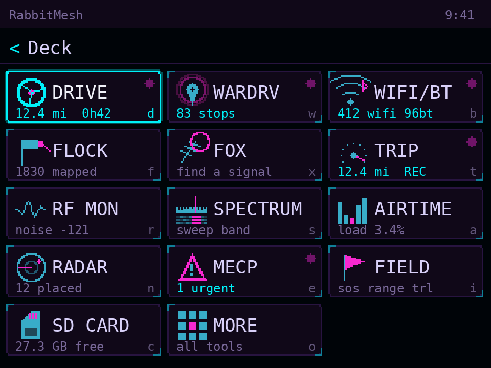
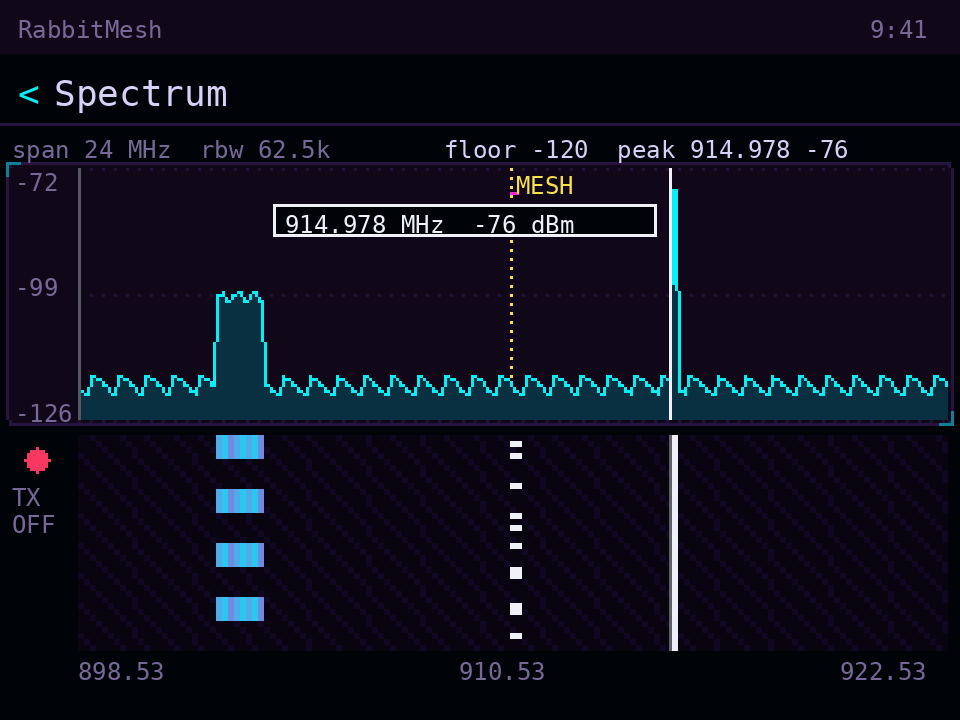
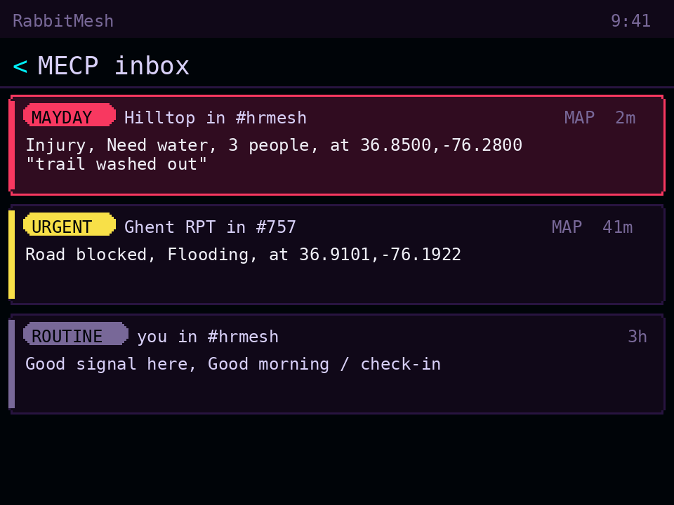
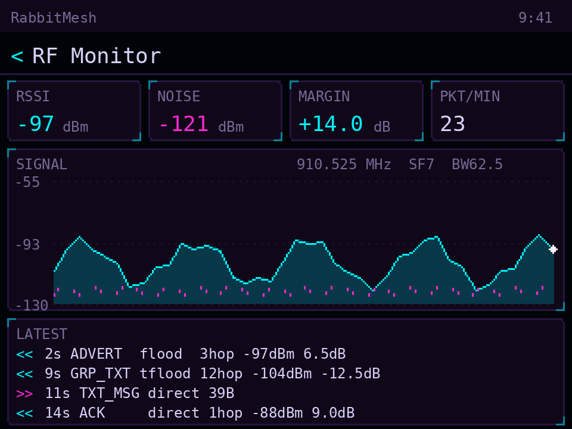
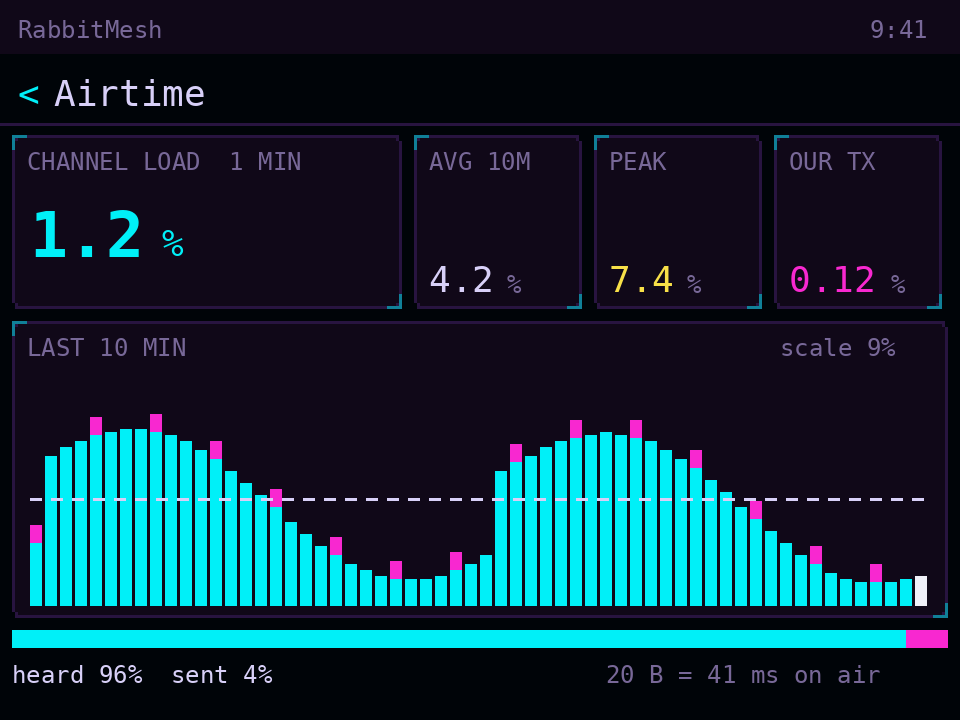
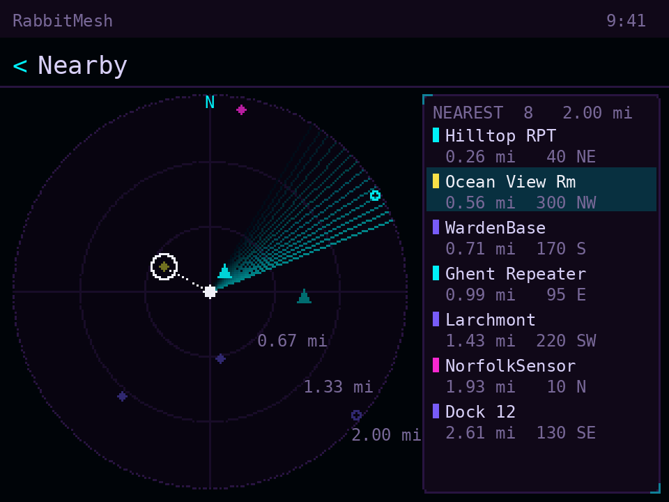
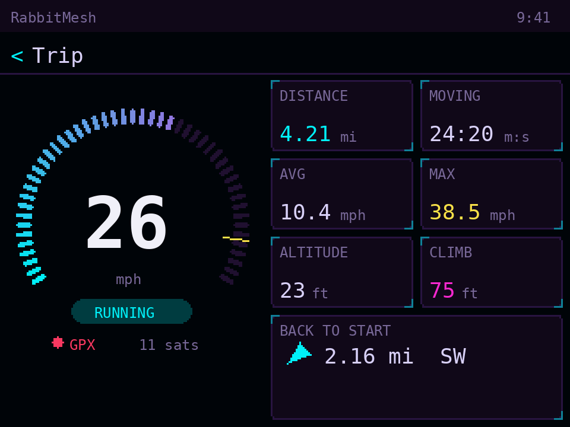

# The tools, in detail

Everything on the T-Deck's **Deck**, what each tool shows, its keys, and what to know before you rely on it. For a quick start, see the [README](../README.md).

**Each tool says what it needs.** The wardrive, WiFi + BT, flock hunt and Drive screens show a live line such as `needs: gps fix ok, sd card NO`, so you can see at a glance why a tool is waiting.

## The Deck

The deck is a hub of 14 tiles, three across. Each tile shows a live figure and its shortcut letter, and tools running in the background pulse. Open it with `t` on the home screen, the **Deck** card or dock button, or Tools > deck. Move with the trackball, tap a tile, or press its letter: `d` drive, `w` wardrive, `b` wifi/bt, `f` flock, `x` fox, `t` trip, `r` rf monitor, `s` spectrum, `a` airtime, `n` radar, `e` mecp, `i` field, `c` sd card, `o` more (`1`–`9`/`0` open the first ten).

| Tool | What it shows | Controls |
|---|---|---|
| **Drive** | one press for a drive: starts the trip (with its GPX track), the mesh coverage survey, the WiFi + BT wardrive and the camera warnings; live figures while you drive, and a summary when you stop (time and distance, mesh stops and new repeaters, networks and devices, cameras passed, the files saved). Anything already running is left alone; one that can't run beside another is skipped and the page says why | press: start / stop and see the summary |
| **RF Monitor** | RSSI, noise floor, link margin (SNR above what your spreading factor still decodes), packets a minute; a signal chart with the noise floor dashed under it; the latest packets; pick one with up/down and press for what it was: who sent it (an advert's or a message's sender, named from your contacts), the repeater it came through, hops, signal and margin, time on air | press: full packet sniffer, `l`: packet log to SD on/off |
| **Airtime** | channel load over 1 min and 10 min, the peak, your own share; 10 minutes of bars, heard vs sent; the EU duty-cycle limit when you're on 863–870 MHz; what one packet costs on the air | |
| **Radar** (Nearby) | every contact with a position on a sweeping scope round you, north up, repeaters as triangles; nearest first with distance and bearing; past the edge shown as a ring on the rim | roll up/down: pick, left/right or `z`/`x`: range, press: contact details |
| **Trip** | a speed gauge with your top-speed mark; distance, moving time, average and max speed, altitude and climb; an arrow back to the start; a GPX track at `/rabbit/tracks/trip-<date>.gpx`, readable even if the battery dies mid-trip. It survives a restart: a running trip carries on after a reboot or a flat battery, distance, moving time and track and all | press: start/stop, `g`: GPX on/off |
| **Spectrum** | a swept analyzer: 160 frequencies across 2, 8 or 24 MHz around the mesh channel, each read through a 62.5 kHz filter; the live trace, a peak hold that sinks 1 dB a sweep, the mesh channel marked, a cursor readout, and a waterfall of the last 36 sweeps | left/right: cursor, up/down or `z`/`x`: span, press: hold (gives the mesh its radio back), `c`: centre on cursor, `m`: centre on mesh, `p`: clear peaks |
| **MECP** | write: severity, up to 8 codes from 12 categories, people, your GPS position, a note, the channel; shows the exact text and its length before sending; a MAYDAY asks once more. Inbox: every MECP line in your chats, decoded, newest first, coloured by severity | inbox: press opens the position on the map |
| **Fox hunt** | find a transmitter by walking toward it: a smoothed signal meter with the peak marked, stronger / weaker / steady, and a Geiger-counter click that speeds up and rises as you close in. **Any signal** (LoRa) is passive: every mesh packet heard, and the mesh carries on. **Repeater** (LoRa) pings one repeater, room or sensor zero-hop every 8 s and follows its answers, saying when it doesn't answer. **WiFi** lists the networks in range, strongest first; pick one and the T-Deck reads just that access point, by its address on its channel, about once a second, on a WiFi scale (-95 to -30 dBm). **Bluetooth** does the same for a Bluetooth device, by its address, listening a second at a time (passive: nothing is sent); devices on a fixed address are listed first, because a phone's random address changes every few minutes. A running WiFi + BT wardrive pauses while you follow something and carries on after; the flock hunt's listening has to be stopped first Walking with a GPS fix, it also says **which way is stronger**: it fits the signal against where each reading was taken and gives the bearing (and, moving, ahead / left / behind) once you've covered 15 m or so, turning | `m`: mode, press: look for repeaters / list wifi networks, left/right: pick one, `s`: sound, `p`: reset peak |
| **WiFi + BT** | classic wardriving with the ESP32's own radio, beside the mesh: WiFi access points every 8 s and Bluetooth LE devices (a 3 s listen every 10 s), each logged with the GPS position to a WiGLE CSV that uploads to wigle.net as it is; live counts of what's in range and what's been logged, open networks, and the latest names. It scans with or without a GPS fix and with or without an SD card, but logs only with both. Each entry in the live view shows its MAC address (and channel); a Bluetooth device on a random address says so. **Follow one** (in its menu) lists what it saw in the last two minutes, strongest first: pick one and the fox hunt opens locked on it, with the meter and the direction arrow | menu: start/stop, live view, follow one, WiFi and BLE on/off |
| **Flock hunt** | finds Flock Safety ALPR cameras two ways and checks one against the other: a camera map on the SD card (warns as you come within 300 m, with the way it faces and who runs it), and the radio listening for what the cameras send. Heard within 150 m of a mapped camera: **CONFIRMED**. Heard with nothing mapped near: **not on the map** (worth adding to OpenStreetMap). The strongest one heard drives the Geiger click. While it follows one, walking or driving with a GPS fix, it says which way it is stronger, as the fox hunt does. "Update camera map" turns the T-Deck's WiFi on by itself if you have a network saved, and off again after; once you have a map it refreshes itself once a day while you're on WiFi | menu: live view, listen on/off, update camera map, radius, US/Canada, approach warnings, sounds |
| **Wardrive** | the mesh coverage survey: see [Wardrive](#wardrive-mesh-coverage) below | menu: start/stop, live view, show coverage, review a run |
| **Field** | range test (a discover every few seconds, logged), SOS (a call for help on a channel every 5 minutes, after a 20-second countdown you can cancel), breadcrumb trail (with a way back to the start) | menu |
| **SD card** | how full the card is; what each tool saved (files and size per folder); the files newest first; a look at the start of one; delete a file or a folder's logs (each asks first) | press: open, backspace: back |
| **More** | the full Tools list (Discover, GPS, settings and the rest) | |

**Packet log.** `l` on the RF Monitor writes every packet heard or sent to `/rabbit/packets/pk-<date>-<time>.csv`: `time_utc,uptime_ms,dir,type,route,hops,len,rssi_dbm,snr_db,lat,lon`. The RF Monitor's header shows LOG and the count while it runs.

**WiFi + BT wardrive, what to know.**
- **Log:** `/rabbit/wigle/wigle-<date>-<time>.csv`, in WiGLE's published CSV format 1.6 (checked against [api.wigle.net/csvFormat.html](https://api.wigle.net/csvFormat.html)): the 14 columns, `Misc [LE]` and the Bluetooth manufacturer id for BLE rows, channel and centre frequency for WiFi, and the pre-header naming RabbitMesh's version, the T-Deck and the ESP-IDF release. Nothing is logged without a GPS fix and a UTC time.
- **No junk rows:** a transmitter is logged when first seen, and again only after a minute *and* 50 m of travel, so a parked T-Deck doesn't write the same networks over and over. Accuracy is the GPS's HDOP × 5 m (a cautious guess from the satellite count if it isn't reported).
- **No WiGLE API:** RabbitMesh never contacts WiGLE: no API calls, no account, no automatic upload. It only writes the file; you upload it yourself at wigle.net (Uploads), under WiGLE's end-user agreement.
- **WiFi radio:** it's shared with the T-Deck's WiFi setting (Settings > WiFi, used for the clock and the camera map). With that WiFi off, the wardrive switches the radio on just to scan and off again after. With it on and still joining a network, a scan can't start, so it tries again a couple of seconds later.
- **Bluetooth:** passive (listen only), beside MeshCore's Bluetooth link to the phone app.
- **What's in the file:** network names, MAC addresses and device names that nearby equipment broadcasts publicly. Uploading it to WiGLE, or not, is up to you.

**Flock hunt, what to know.**
- **The map** comes from OpenStreetMap, where the DeFlock community maps ALPRs, via the [deflock-data](https://github.com/flockhopper3/deflock-data) project's daily static file (about 147,000 cameras in the US). "Update camera map" downloads it over WiFi (Settings > WiFi; about 4 MB, gzip) **at most once a day**, keeps the cameras within the radius you pick (50-500 km) round your GPS position (or, indoors with no fix, your saved position), and writes `/rabbit/alpr/cameras.bin`. It never uses the Overpass API: one static file for everyone, so it adds nothing to that overloaded service however many people run RabbitMesh. Map data © OpenStreetMap contributors, ODbL.
- **A bigger map** (a whole state, or the country): run `tools/alpr_extract.py` on a computer (Python 3, nothing to install) and copy its `cameras.bin` to the card. It makes the same file as the T-Deck, byte for byte, and also fetches the file at most once every 20 hours. `python3 tools/alpr_extract.py --help` for the options.
- **The radio** listens (promiscuous, receive-only: nothing is ever sent at a camera) for the cameras' WiFi probe requests, with the signatures and confidence tiers of [flock-you](https://github.com/colonelpanichacks/flock-you): *camera signature* (prefix + wildcard probe + the drive-tested fingerprint), *likely camera* (prefix + wildcard probe), *possible camera* (prefix only, or a camera battery's Bluetooth), *echo* (an access point answering one; the weakest). Per that research the cameras' own WiFi network went away around December 2025 and their Bluetooth went quiet in the spring, which is why the probe requests are what it listens for. **Laptops aren't cameras:** 22 of the 34 camera prefixes are Liteon's, and the rest of the shared ones belong to USI, Silicon Labs, Espressif and Samsung, makers whose WiFi modules sit in laptops, phones, printers and smart gadgets (checked against the IEEE registry). Every laptop looking for WiFi also sends wildcard probes. So a hit from one of those makers that is only the prefix, an echo or a bare probe shows as what it is, e.g. *Liteon radio - laptops use these too*, muted, with no alarm, and the meter follows any camera-grade hit before it. The camera's own fingerprint, a hit near a mapped camera, Flock's own prefix, the camera radio's default Atheros address and the battery packs' Bluetooth still count as cameras (`flock_core.h` `vendorOnly`, with host tests).
- **While listening** the WiFi radio hops channels 11, 6 and 1, so WiFi (Settings > WiFi) must be off and the WiFi + BT wardrive stopped. Bluetooth checks run at about 10% of the time alongside.
- **The log:** `/rabbit/flock/flock-<date>-<time>.csv`: `time_utc,lat,lon,mac,tier,how,radio,rssi_dbm,channel,mapped_m,confirmed,maker_only` (`maker_only`: the maker's name when the hit says no more than that, e.g. `Liteon`), a row when a camera is first heard, when its tier rises, and again after a minute and 50 m.
- **US and Canada only:** that's where the cameras are, and the prefix list won't match anything elsewhere.

Airtime and the monitor's history are collected all the time in the background, so they already have data when you open them. Like the wardrive, a running trip keeps the GPS on and carries on with the screen off. Distances and speeds follow the miles/km setting.

**Spectrum: what to know.**
- **The mesh pauses while it sweeps.** The radio can only listen on one frequency, so your node can't hear or relay mesh traffic. Anything you send waits in the queue and goes out afterwards. The header says **MESH PAUSED**.
- **Hand-back is automatic.** The radio goes back to the mesh, with its settings restored, when you leave the screen, press **hold**, the display goes dark, or anything covers the screen for more than 1.5 s.
- **It won't start during a survey.** It refuses while a wardrive or range test is running, because those need the radio.
- **It's a coarse instrument.** A full sweep takes about a second. Each bin listens through a 62.5 kHz filter, but the bins are spaced up to 150 kHz apart at the widest span, so a narrow carrier between two bins can be missed. Zoom in to 2 MHz to look closely. It's a radio-hunting and interference tool, not lab equipment.
- **It reads 150–960 MHz**, the SX1262's range, around your mesh channel. `c` re-centres on any frequency the cursor is on.

**MECP alerts.** A MAYDAY or URGENT arriving on any channel wakes the screen, shows a 20-second banner (tap it for the inbox), buzzes (on a board with a vibration motor; the T-Deck has none), and plays a short siren, even if that channel is muted. The override can be switched off in the MECP menu. SAFETY and ROUTINE messages arrive like any other message and show up decoded in the inbox. MECP is plain text, so anyone without a decoder still sees a readable `MECP/0/M01 S01 …` line.

| Spectrum | MECP inbox |
|---|---|
|  |  |
| **RF Monitor** | **Airtime** |
|  |  |
| **Radar** | **Trip** |
|  |  |

## Wardrive (mesh coverage)

It runs as a survey. It **probes** rather than listening: a zero-hop discover that every repeater in range answers. A reply proves the link works from where you're standing, and it carries both directions:

- **they hear us**: how well they heard you, i.e. your transmit reach
- **we hear them**: how well you heard them, i.e. your receive reach
- **both ways**: the weaker of the two, the link you can actually use (the default)

What it does:
- **Probe timing:** a probe goes out at most every 15–120 s (default 20 s), sooner once you've moved 25–500 m (default 50 m), and every 1–10 min while parked. With no GPS fix it doesn't probe, since a reply it can't place would waste airtime.
- **Late replies:** if replies arrive after you've moved more than 250 m, or after a stalled loop, they're dropped rather than put on the map in the wrong place.
- **Log file:** each run goes to `/rabbit/wardrive/wd-<date>-<time>.csv` on the SD card:
  `time_utc,lat,lon,alt_m,sats,drift_m,type,name,key,they_hear_us_db,we_hear_them_db,rssi_dbm`.
  A probe nobody answered gets a `none` row, because a dead zone is coverage data too.
- **Map overlay:** one dot per probe, cyan-green for strong, yellow for marginal, red for weak, and a hollow red ring where nothing answered.
- **Live view:** stats, plus a per-repeater table with best/worst link and both directions.
- **Review:** loads any past run, or a Squatch range-test log from `/inw/range`, onto the map. Probing pauses while you review.
- **Background running:** it keeps the GPS and the main loop awake through the field-tool hooks, so it carries on with the screen off.
- **While driving:** a tone after each probe climbs with the link (a low blip when nothing answered), so you can hear coverage without looking. A repeater no run has seen before gets a fanfare and a toast; the ones seen are kept in `/rabbit/wardrive/known.txt`. Both can be turned off in the menu.
- **Export:** review a run, then export it to Google Earth (KML, coloured by link) or GeoJSON, in `/rabbit/wardrive/export`.

## Clock, time zone and holidays

**The time from the mesh.** The T-Deck has no clock chip. With no GPS fix, no internet and no phone app, MeshCore starts the clock at the newest contact change it has saved, which can be minutes or days behind. Every advert carries its sender's clock, though, so RabbitMesh keeps the latest time from each node it hears and, once at least three different nodes agree within 90 seconds, sets the clock to theirs (`src/meshclock_core.h`, with host tests; `src/meshclock.cpp`). One node with a wrong clock can't move it, it only ever moves the clock forward, and it stays out of the way while the GPS has a fix or WiFi is connected (they set the clock themselves).

**Time zone from location.** Settings > Clock & time > time zone > "set it from location (gps)", on by default. Once a minute it works out the zone (`src/tz_core.h`) from the GPS's fix, or, with none (indoors, or before the first fix), from the node's saved position (the last fix, or one set by hand or from the phone app), and switches the clock to it, daylight saving included. A fresh install starts on UTC until it has one or the other. It covers:
- **US:** the split states on their county lines, Arizona, Hawaii and Alaska.
- **Canada:** Saskatchewan without daylight saving, Newfoundland and the Maritimes.
- **Mexico:** its 2022 rules, including the border towns that keep US-aligned time.

It is tested on 111 real towns either side of the lines. Within a few km of a zone line it can pick the neighbour; picking a zone by hand turns it off so your choice sticks. Outside North America it leaves the zone alone. The date and time themselves come from the GPS, the phone or the mesh, as before.

**Holidays by date.** Each holiday's theme shows by itself while the holiday lasts, then the T-Deck goes back to the theme you chose (yours is never changed). Picking a theme in the menu during a holiday keeps yours until that holiday is over. "Holiday themes by date" in the theme menu turns it off. It goes by the local date, so the clock has to be set (GPS, phone or mesh). The dates (`src/holiday_core.h`, with host tests):

| Holiday | Shown |
|---|---|
| Halloween | Oct 15-31 |
| Thanksgiving (US) | the Friday before the 4th Thursday of November to the Sunday after |
| Christmas | Dec 1-26 |
| New Year's | Dec 31 - Jan 1 |
| Easter | the week before Easter Sunday (worked out each year) to Easter Monday |
| 4th of July | Jul 3-5 |
